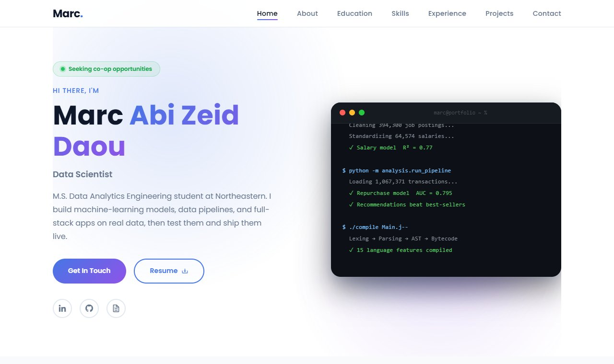

# Marc Abi Zeid Daou — Portfolio

Personal portfolio of Marc Abi Zeid Daou, M.S. Data Analytics Engineering student at Northeastern University
(B.S. Computer Science, UMass Boston). It presents my machine-learning and data projects, experience and resume.

**Live site: https://marcazdaou.github.io/my-portfolio/**

[](https://marcazdaou.github.io/my-portfolio/)

## Featured projects

| Project | What it is | Links |
|---|---|---|
| **Job Market Analytics** | Data science study of 394,300 job postings: salary pipeline, leakage-safe ML model (R² 0.77), bootstrap CIs and fixed-effects pay gaps | [Live dashboard](https://job-market-analysis-ndmqelnezlfa64hyyhhwkv.streamlit.app/) · [Code](https://github.com/marcazdaou/Job-Market-Analysis) |
| **Green Thumb** | Django store on 1M+ real retail transactions: repurchase prediction (ROC AUC 0.795), basket recommendations, Stripe test-mode checkout | [Live site](https://green-thumb-1-lc2c.onrender.com) · [Code](https://github.com/marcazdaou/Green-Thumb) |

## Built with

- **HTML, CSS and vanilla JavaScript**: no framework or build step
- Animated terminal and typewriter effect (`assets/js/main.js`)
- Responsive layout from phone to desktop (`assets/css/styles.css`)
- Contact form via [EmailJS](https://www.emailjs.com/), icons from [Boxicons](https://boxicons.com/)
- Hosted on **GitHub Pages**

## Structure

```
index.html               All sections: home, about, education, skills, experience, projects, contact
assets/css/styles.css    Styles
assets/js/main.js        Navigation, typewriter, terminal animation, card effects
assets/img/              Photos and project screenshots
assets/MarcDaoucv.pdf    Resume (download button)
```

## Run locally

Open `index.html` in a browser. No install needed.

## Contact

[LinkedIn](https://www.linkedin.com/in/marc-abi-zeid-daou/) · [GitHub](https://github.com/marcazdaou) · marcazdaou@gmail.com
